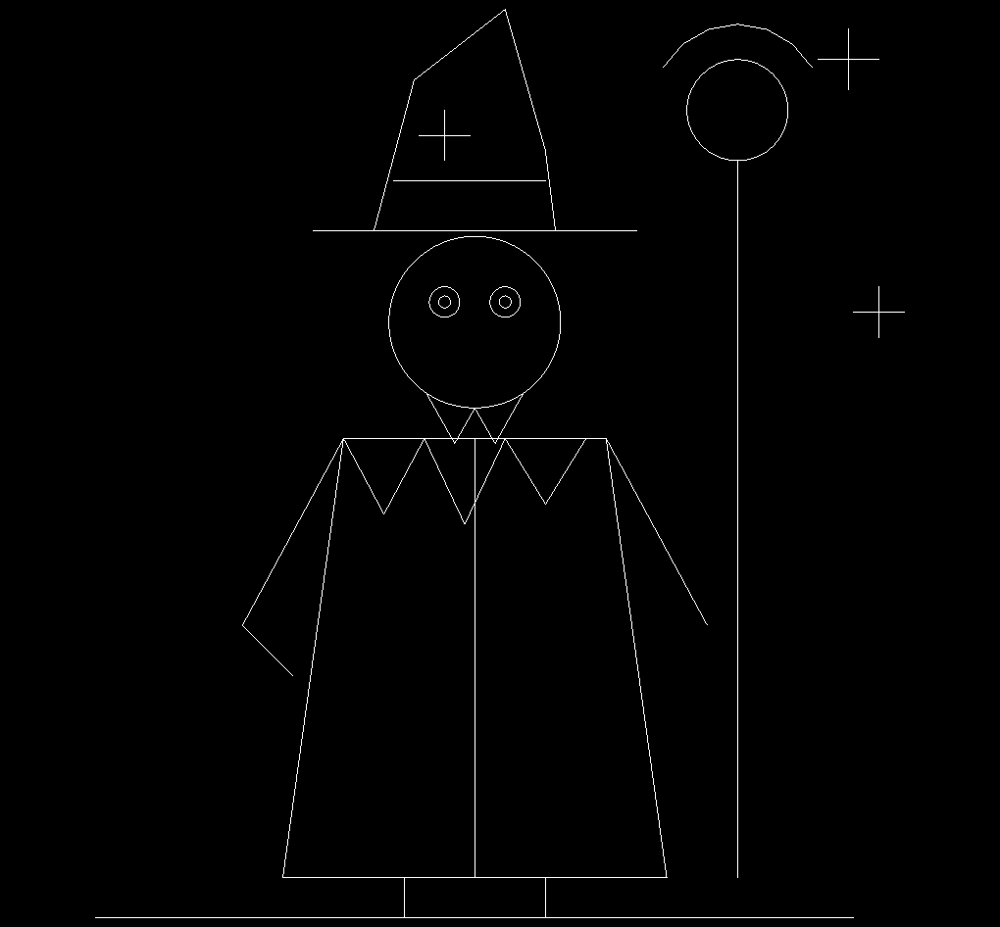

# draftsight-api for pi-coding-agent

A [pi](https://pi.dev) package: a skill for driving **DraftSight 2026** on Windows through **COM
automation** - draw, edit, save, and export DWG files programmatically, and verify results by
reading geometry back instead of trusting return codes.

COM is the primary transport because it is the only one that works: the local HTTP/JSON API on
`127.0.0.1:7776` has a broker that crashes on the first JS-RPC request, reproduced on SP3 and SP4
across two installs, with no client-side recovery. The HTTP path is still documented - as a
fallback, and as the failure catalogue that produced most of the rules this skill carries.

**Platform: Windows only.** DraftSight's API broker, the
`C:\ProgramData\Dassault Systemes\DraftSight\` file sandbox, and the `hh.exe` help decompiler are all
Windows-specific.

## What it produces



Every line above was placed by API calls - no mouse, no UI interaction, no manual drawing. The image
is not a screenshot either: it is `dsDocument.ExportToPng`, DraftSight's own renderer writing the
file, so the application verified the result instead of a window capture of it.

The sessions that produced it also settled the parts of the API that are not in the manual
(these findings are mostly on the HTTP path, which is where the surprises are):

- API file I/O is confined to `C:\ProgramData\Dassault Systemes\DraftSight\`; every file crossing that boundary has to be staged there first
- `SaveAs` is obsolete on the HTTP path and fails for every option there, where `SaveAs2` is the call that works. Over COM it is the reverse in practice: `SaveAs($path, 28, [ref]$err)` returns `0` and writes a reopenable DWG
- `RunCommand` reports `Succeeded` for commands that do not exist - there is no `ZoomExtents`, the command is `ZoomFit`
- `ExportToEmf` takes the jsServer down; `GetDocuments` preceded a crash

That is what this skill carries: the working calls **and** the failures, so the next session starts
from the answer instead of from the crash.

## Install

```bash
pi install git:github.com/3DAlgoLab/draftsight-api
```

Pin a ref instead of tracking the default branch (`master`):

```bash
pi install git:github.com/3DAlgoLab/draftsight-api@v1.0.0
```

Try it for a single invocation without writing anything to settings:

```bash
pi -e git:github.com/3DAlgoLab/draftsight-api
```

## Remove

```bash
pi remove git:github.com/3DAlgoLab/draftsight-api
```

## After installing

The decompiled API reference is **not** in git - it is Dassault-copyrighted and rebuilds in seconds,
so a fresh install has no `docs/` until you generate it:

```bash
cd ~/.pi/agent/git/github.com/3DAlgoLab/draftsight-api
bash skills/draftsight-api/scripts/decompile-chm.sh
```

Requires DraftSight installed at `C:\Program Files\Dassault Systemes\DraftSight\`. The skill is
useful without `docs/`; the reference just makes it able to look signatures up instead of guessing.

**`pi update --extensions` deletes `docs/`.** Pi cleans untracked files when it reconciles a git
package, so the reference is removed on every update. Re-run the command above afterwards.

Pi clones git sources to `~/.pi/agent/git/github.com/3DAlgoLab/draftsight-api` and identifies them by
repository URL, so a local copy of this folder and the installed clone never load twice.

## Contents

```
skills/draftsight-api/
├── SKILL.md              routing, the hard rules, trust table, do-not-call list
├── references/
│   ├── com-api.md        COM transport: signatures, traps, tables, selection sets
│   ├── protocol.md       HTTP transport: failure catalogue, crash log, sandbox proof
│   └── signatures.md     verified signatures and enum values
├── scripts/
│   ├── com-inspect.ps1       read the live selection over COM
│   ├── com-draw-example.ps1  draw, fit, export - the minimal COM loop
│   ├── com-table.ps1         CSV to a sized DraftSight table, verified by read-back
│   ├── com-section-hatch.ps1 hatched section: layers, point-loop hatch, dimensions, save + reopen proof
│   ├── com-signature-oracle.ps1 read real in/out/ref signatures off the shipped interop assembly, offline
│   ├── com-entities-dump.ps1 early-bound entity inventory per layer - verification without screenshots
│   ├── com-plot-frames.ps1   find every sheet frame in model space, plot one PDF per frame
│   ├── verify-plot.py        check a plotted PDF: page size, ink margins, vector vs rasterised colour
│   ├── ds-call.sh        handshake + one-call API client
│   ├── decompile-chm.sh  regenerate docs/ from the installed DraftSight help
│   └── html2txt.sh       strip tags from help pages for grepping
└── docs/                 NOT in git - ~6,500 decompiled help pages, ~76 MB
```

## What the skill encodes

The rules that cost the most to rediscover:

- COM is the primary transport: same object model, no broker, no ports, no path sandbox. The HTTP rules below apply only to the fallback.
- Echo `{id, macroId, type}` back verbatim on every HTTP call; `macroId` is a session epoch that resets when DraftSight restarts.
- HTTP file I/O is confined to `C:\ProgramData\Dassault Systemes\DraftSight\`; any file crossing the boundary must be staged there first. COM writes anywhere.
- Enum parameters take symbolic names as strings (`"dsDocumentSave_R2018_DWG"`), not integers.
- `SaveAs` is obsolete on HTTP - use `SaveAs2`. Over COM, `SaveAs($path, 28, [ref]$err)` is the one that works; `0` means saved.
- `ExportTo*` and `SaveAs2` return values are evidence; `RunCommand`'s `"Succeeded"` is not.
- DraftSight command names are not AutoCAD's: there is no `ZoomExtents`, the command is `ZoomFit`.
- Over COM, `SelectByPolygon` needs flat x,y,z triples and returns `False` for the wrong shape - a silent no-op, not an error. `SelectByWindow` works via `IApplication.GetMathUtility().CreatePoint()`; the factory is on the application, not the document.
- Absence from a filtered `Get-Member` list proves nothing; an anchored regex hid `SetColumnWidthAt` and produced a wrong rule that had to be retracted.
- The type library is the contract, not `Get-Member` on a live `__ComObject`: `scripts/com-signature-oracle.ps1` reads `APISDK\tlb\DraftSight.Interop.dsAutomation.dll` and prints true in/out/ref signatures before the first live probe.
- `Object`-typed COM parameters refuse `$null` and refuse scalars over late binding, so some calls - `ISketchManager.GetEntities`, `Zoom` with an unused range - are simply unreachable from plain PowerShell. `Add-Type -Path $interop` plus inline C# reaches them, with typed `out` parameters and symbolic enums.
- Creating an object over COM hands it back in an out slot that must be given a live IDispatch: pass an existing `ILayer` / `IDimensionStyle` to `CreateLayer` / `CreateDimensionStyle`; `[ref]$null`, `Type.Missing` and reflection all fail differently.
- Hatch over COM works only through `InsertHatchByBoundary(counts, points, pattern, scale, angle)`; the by-entities and by-internal-points overloads return `null` silently.
- Dimension text height, arrows and offsets are style-level; normalise `SetDimensionScale(1, 1.0)` before setting `Height` or the value is scaled by the style's fit factor. `%%c23` renders with the diameter sign while `.Measurement` still reports the true 23.0.

## Develop

Edit the skill, commit, push, then reconcile:

```bash
pi update --extensions
```

`docs/` and the `*.sh` line endings are protected by `.gitignore` and `.gitattributes` respectively -
`core.autocrlf=true` would otherwise rewrite the shebangs to CRLF and break the scripts under git-bash.
